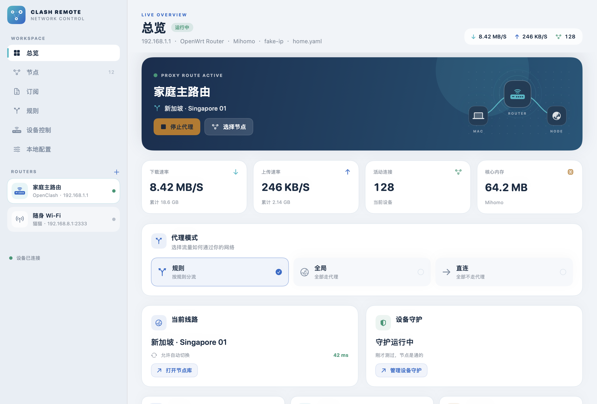
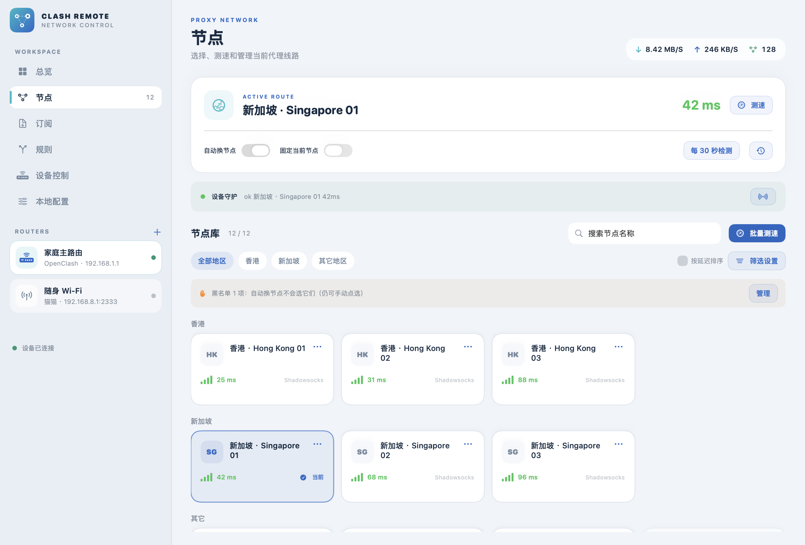

# Clash Remote

**macOS 原生客户端，用来遥控家里的 OpenClash / 猫猫。**

换订阅、切节点、切规则/全局/直连、开 TUN——不必再打开 LuCI 或插件网页。局域网里有一两台 Clash 设备时，这就是那个「专用按钮」。




*新版界面预览，使用示例设备与节点数据。*

---

## 它解决什么

OpenClash 的 LuCI 和猫猫插件都很全，但日常往往只需要按几次：

- 出门前把随身 Wi‑Fi 切到直连，回家再切回规则
- 订阅到期后贴一次链接并更新
- 节点卡了，在一长串名字里点一张卡片

Clash Remote 把这些动作收进一个本机 App：记住多台设备，点一下就能改。它不是再做一个 Yacd，也不是再做一个路由器后台——**只操 Clash**。

## 功能

| 分区 | 能力 |
|------|------|
| **设备** | 多台路由器侧边栏，本地记住登录信息，一键切换 |
| **总览** | 图形化连接路径，实时流量、连接与内存，一键切换规则 · 全局 · 直连 |
| **设备控制** | 启动 / 停止 / 重启，增强 / TUN / Mix，网络选项、配置文件与设备守护 |
| **订阅** | 列出、添加、编辑、删除、更新订阅 |
| **节点** | 地区卡片、搜索筛选、延迟排序与信号标识，批量测速，点选切换和黑名单菜单 |
| **规则** | 域名匹配检查，快速写入分流规则，查看设备当前规则 |
| **本地配置** | 节点筛选、自动切换、订阅收藏与域名规则，保存在 Mac 上并按需同步 |

### 已适配插件

| 插件 | 典型环境 | 默认端口 |
|------|----------|----------|
| **OpenClash** | OpenWrt + LuCI | HTTP `80`，Clash API `9090` |
| **猫猫** | UFI‑TOOLS（如中兴随身 Wi‑Fi） | 面板 `2333`，Clash API `7788` |

本机若开着系统代理（FlClash 等），访问 `192.168.x.x` 常被拐走。应用使用 **Network.framework 直连 TCP** 发 HTTP，局域网请求不走系统代理。

## 系统要求

- macOS **14.0**（Sonoma）或更高
- Apple Silicon 或 Intel
- 与路由器同一局域网，并允许本机「本地网络」权限

## 安装

### 预编译包（推荐）

1. 打开 [Releases](https://github.com/DonVitsch/ClashRemote/releases) 下载最新 `Clash-Remote-x.y.dmg`
2. 打开 DMG，把 **Clash Remote** 拖到 **Applications**
3. 首次打开若被 Gatekeeper 拦截：在 App 上 **右键 → 打开**，或到「系统设置 → 隐私与安全性」里允许

当前发布为 **ad‑hoc 签名**（未做 Apple Developer ID / 公证）。这是个人项目的常见做法；若你更在意 Gatekeeper，可自行用开发者证书重签。

### 从源码构建

```bash
git clone https://github.com/DonVitsch/ClashRemote.git
cd ClashRemote
./build.sh          # 产出 dist/Clash Remote.app
./package-dmg.sh    # 可选：打成 dist/Clash-Remote-<version>.dmg
```

依赖：Xcode Command Line Tools / Swift 6 工具链。

## 快速上手

1. 启动 App，侧边栏点 **+** 添加设备  
2. 填写名称、地址、账号密码，选择插件（OpenClash 或猫猫）  
3. 选中设备后自动连接；顶部可看上下行与连接数  
4. 从侧栏进入 **总览 / 节点 / 订阅 / 规则 / 设备控制 / 本地配置**；日常切模式在总览，核心和守护设置在设备控制

设备保存在：

```text
~/Library/Application Support/ClashRemote/devices.json
```

密码以明文存在本地（与许多路由器面板记住密码的行为类似）。请勿把该文件提交到公开仓库或同步到不可信位置。

## 架构概览

```text
ClashRemote (SwiftUI)
├── DeviceStore          本地设备列表
├── OpenClashService     LuCI / UCI / ubus + Clash API
├── MaoMaoService        Clash API + UFI 签名 shell（订阅写 yaml）
└── DirectHTTP           Network.framework，绕过系统代理
```

- **OpenClash**：模式类操作走 Clash `PATCH /configs`；TUN / 订阅等多走 UCI，并在需要时重启核心  
- **猫猫**：运行时模式与节点走 Clash API；订阅改 `/data/clash/Proxy/config.yaml` 的 `proxy-providers`，再经 `Clash.Service` 重启  

## 项目结构

```text
ClashRemote/
├── Package.swift
├── Info.plist
├── build.sh
├── package-dmg.sh
├── AppIcon.icns / AppIcon.iconset/
└── Sources/ClashRemote/
    ├── App/           入口与状态
    ├── Models/        设备、模式、节点等模型
    ├── Network/       OpenClash / 猫猫 / 直连 HTTP
    ├── Store/         设备持久化
    └── Views/         设计组件、工作区导航、总览与节点卡片
```

## 界面开发

界面支持系统深浅色外观。图案、连接示意、状态色和应用标志均由原生 SwiftUI 绘制。

开发构建可以使用示例数据离屏导出页面，无需连接路由器：

```bash
swift run ClashRemote --render-previews /tmp/clashremote-previews
```

应用图标由同一套原生图形生成：

```bash
swift run ClashRemote --render-app-icon AppIcon.iconset
iconutil -c icns AppIcon.iconset -o AppIcon.icns
```

这些入口仅存在于 Debug 构建。示例数据不会写入设备列表或本地配置。



## 安全与隐私

- 流量只发往你配置的路由器地址，无第三方遥测  
- 为兼容家庭路由的自签 / HTTP 面板，Info.plist 允许任意 ATS 负载；请仅在受信局域网使用  
- 首次连接请在系统弹窗中允许「本地网络」

## 已知限制

- 面向「一两台家里的 Clash 设备」，不是网管平台  
- 不管理 Wi‑Fi 密码、短信、Magisk 等与 Clash 无关的能力  
- 猫猫订阅依赖 UFI 登录签名与设备上的路径约定，其他定制固件可能不兼容  
- 未做 Developer ID 公证；分发依赖用户手动允许打开

## 许可证

[MIT](LICENSE) © DonVitsch

---

灵感来自每天为「按三次」开三个网页的烦躁。若它也帮到你，欢迎 Star 或提 Issue。
